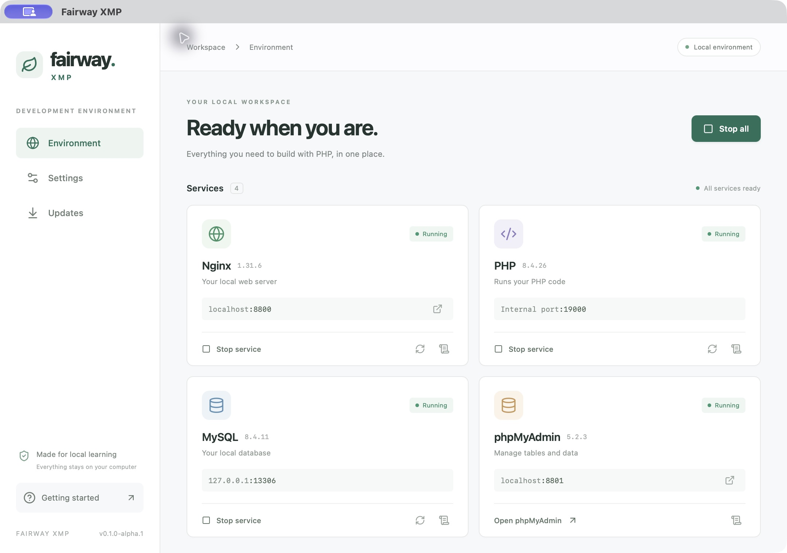

# Fairway XMP

A PHP development environment for Windows and Apple Silicon Macs. Run your web server and database from one control panel, write code in your preferred editor, and manage your data in phpMyAdmin.



## Downloads

Current release: **[v0.1.0-alpha.2](https://github.com/eimg/fairway-xmp/releases/tag/v0.1.0-alpha.2)**.

| Computer | Requirements | Download |
| --- | --- | --- |
| Windows | Windows 10 22H2 or Windows 11, x64 | [Windows installer](https://github.com/eimg/fairway-xmp/releases/download/v0.1.0-alpha.2/Fairway-XMP-0.1.0-alpha.2-windows-x64-setup.exe) |
| Mac | macOS 15 or later, Apple Silicon (M-series) | [Mac installer](https://github.com/eimg/fairway-xmp/releases/download/v0.1.0-alpha.2/Fairway-XMP-0.1.0-alpha.2-macos-arm64-unsigned.pkg) |

Download the installer for your computer and follow its prompts. The installers are unsigned, so Windows may show an unknown-publisher warning. If macOS blocks the installer or app, follow [Apple’s instructions for opening an app from an unidentified developer](https://support.apple.com/en-us/102445).

## What’s included

- **PHP 8.5.11** with common extensions for PHP projects and Laravel.
- **Composer 2.10.3** for installing PHP packages.
- **Nginx 1.30.5** for serving your projects.
- **MySQL 9.7.2 LTS** for local databases.
- **phpMyAdmin 5.2.3** for managing tables and data in your browser.

The control panel provides service controls, port settings, logs, and database backups.

## Your first PHP project

1. Open Fairway XMP and click **Start all**. Wait for **All services ready**.
2. Click **Open folder** to open your project folder, `fairway/www` in your home folder.
3. Create a folder named `hello` and add an `index.php` file:

   ```php
   <?php
   echo 'Hello from Fairway XMP!';
   ```

4. Open [http://127.0.0.1:8800/hello/](http://127.0.0.1:8800/hello/) in your browser.

Closing or minimizing the window keeps Fairway XMP and its services running. Use its macOS menu bar or Windows system tray icon to reopen the panel, start/stop all services or individual Nginx/MySQL services, open phpMyAdmin, or **Quit**. Nginx automatically manages its PHP worker; PHP CLI works without starting services. Quit gracefully stops all services before exiting.

## PHP and Composer in your terminal

After installation, reopen your terminal and editor so they can find PHP and Composer:

```sh
php --version
composer --version
```

Manage this integration under **Settings → Command-line tools**. You can also use **Open terminal** in the control panel.

For projects with their own development server, run the usual command, such as Laravel’s `php artisan serve`.

## Your database

Click **Open phpMyAdmin**, or visit [http://127.0.0.1:8801/](http://127.0.0.1:8801/). Sign in with username **fairway** and password **fairway**.

Use these connection settings in your PHP projects:

| Setting | Value |
| --- | --- |
| Host | `127.0.0.1` |
| Port | `13306` |
| Database | `fairway` |
| Username | `fairway` |
| Password | `fairway` |

You can create additional databases in phpMyAdmin. Services accept connections from your computer only.

To save a SQL backup, click **Back up databases**. Find saved backups under **Settings → Open backups**, and import them through phpMyAdmin when needed.

## Ports

| Service | Default port |
| --- | --- |
| Website | `8800` |
| phpMyAdmin | `8801` |
| MySQL | `13306` |
| PHP’s connection to Nginx | `19000` |

If a port is already in use, Fairway XMP shows the conflict. Stop all services, change the port in **Settings**, and save. If you change the MySQL port, use the new port in your project’s database settings.

## Updates and removal

Open **Updates → View downloads** to get a newer installer. Stop all services and quit Fairway XMP before installing it. Your projects and database data are kept.

To uninstall:

- **Windows:** open **Settings → Apps**, select **Fairway XMP**, and choose **Uninstall**.
- **Mac:** quit Fairway XMP, then open **Applications** in Finder. Right-click **Fairway XMP → Show Package Contents**, open **Contents → Resources**, and double-click **Uninstall Fairway XMP.command**.

The uninstaller removes the app and its command-line integration. Your projects and database data are kept unless you choose to delete them.

## Help and license

For problems or suggestions, [open an issue](https://github.com/eimg/fairway-xmp/issues). Include your operating system, what you tried, and any error shown in Fairway XMP.

Fairway XMP’s application code uses the [MIT license](LICENSE). Included tools have [their own licenses](THIRD_PARTY_NOTICES.md). Release checksums and bundled-tool sources are available on the [release page](https://github.com/eimg/fairway-xmp/releases/tag/v0.1.0-alpha.2). For contributing to the app, see [Contributing](CONTRIBUTING.md).
