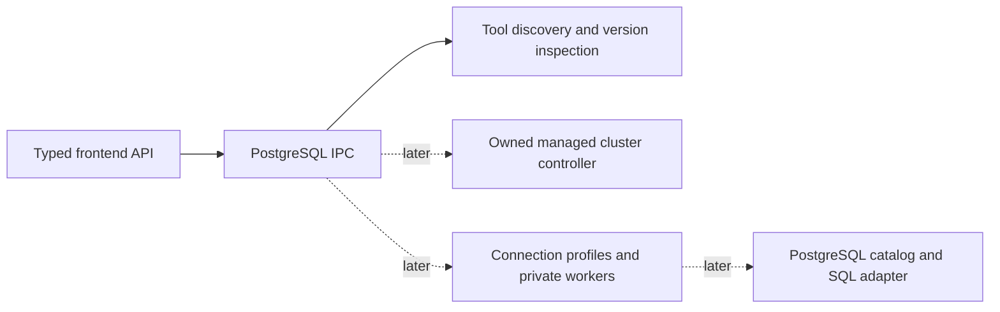

# PostgreSQL integration — Phase 2, Stage 1

Stage 1 adds read-only runtime discovery and an architecture for later PostgreSQL
work. It does not ship a PostgreSQL server, initialize a cluster, connect to any
server, or add service/explorer controls. No PostgreSQL version is qualified for
managed use by a successful discovery or version check.

## Independent ownership and modules

PostgreSQL must be independent of MySQL: separate process ownership, data,
configuration, ports, secrets, logs, backups and health. Do not add it to the current
`Ports` JSON, reuse MySQL credentials, or route it through MySQL Start All/Stop All.
External servers remain externally owned even when Fairway connects to them.

Only the solid path exists in Stage 1:

| Module | Responsibility |
| --- | --- |
| `src-tauri/src/postgresql.rs` | Runtime DTOs, typed errors, independent discovery state and inspection gate |
| `postgresql/discovery.rs` | Bounded install-root search, canonical deduplication, native-file checks, fresh candidate selection |
| `postgresql/version.rs` | Fixed clean `--version` commands and stable PostgreSQL version parsing |
| `desktop/postgresql_commands.rs` | Two async Tauri commands, outside the PHP manager lock |
| `src/postgresql/types.ts`, `api.ts` | Matching TypeScript DTOs and explicit command wrappers; no automatic calls or new UI |

Constructing discovery performs no IO. It is registered independently before the
existing startup manager, so a PostgreSQL discovery failure cannot initialize or
repair MySQL/PHP. Existing startup, Node services, database workers, settings,
packaging and runtime locks remain unchanged. The existing bounded command-output
helper is made available on Unix as well as Windows; its implementation is unchanged.

Later modules should remain separate: `managed` (cluster journal/controller),
`profiles` (metadata), `secrets` (OS vault abstraction), `connections` (job/session
ownership), `catalog` (read operations), `query` (explicit SQL), and `backup`.
Do not create these dormant implementations in Stage 1.

## Discovery and version contracts

`postgres_runtime_discover()` returns `{candidates, truncated, notes}`. It reads
only directory entries, executable metadata and four header bytes; it runs nothing.
Sources are the future `runtime/postgresql/bin`, absolute `PGBIN`, standard
Homebrew PostgreSQL/libpq opt directories, Postgres.app version directories,
Linux distro paths, Windows Program Files PostgreSQL version directories, and
absolute entries in the app's inherited PATH. No shell startup or package-manager
command runs. No services, registry service definitions, cluster directories,
`PG_VERSION`, `.pgpass`, `pg_service.conf`, profiles, sockets or ports are inspected.

Search is bounded to 64 roots, 128 entries per version-parent directory and 24
canonical candidates. A truncation flag signals incomplete enumeration. Symlinked
install directories deduplicate to the same bin directory. Relative/empty PATH
entries, control characters, oversized paths and Windows UNC roots are skipped.
Custom prefixes absent from PGBIN/PATH and container/remote servers are not inferred.

Each candidate has a path-derived SHA-256 ID, origin, canonical bin directory,
and these fixed tool slots: `postgres`, `initdb`, `pg_ctl`, `psql`, `pg_isready`,
`pg_dump`, `pg_restore`, `pg_dumpall`. Missing tools remain missing. A client-only
libpq install does not imply a local server. The `fairwayRuntime` origin describes
where tools were found; it never grants ownership of a cluster/process.

`postgres_runtime_inspect({candidateId, confirmed:true})` refreshes discovery before
selection and runs only native fixed-name executables with exactly `--version`.
It accepts no executable path, shell command, connection URL or additional arguments.
Native-format headers and executable permissions are checked; wrappers/scripts,
special files and tool symlinks escaping the canonical bin are refused. Files are
opened without following final symlinks and nonblocking on Unix, then checked again
before probing. This is a safety filter, not signature validation or a sandbox
against malicious native code or same-user path replacement. A candidate ID is
not a persisted execution/ownership token; Stage 2 must revalidate tools and files.

The child environment is cleared; only C locale and Windows SystemRoot are set.
No inherited PGDATA, PGHOST, PGPASSWORD, loader hooks or shell config reach it.
Each command has a two-second maximum; the candidate has an eight-second scheduling
budget (a final rounded one-second probe can extend it by less than one second).
Output capture is bounded by the existing helper; timeout/cancel cleanup uses only
its owned process group/job. Calls cannot overlap version inspection. Raw stdout,
stderr, environment and exception details never enter diagnostics or IPC errors.

Only stable numeric releases are parsed, including legacy three-part versions.
Prereleases, wrong tool banners, malformed and multiline output are rejected.
Vendor annotations are discarded. `serverTools` checks postgres/initdb/pg_ctl;
`clientTools` checks the five clients separately. `verified` means all tools in
that group returned the same exact version. It does not mean compatibility,
authentication, readiness, a qualified managed release or client/server compatibility.
The groups may have different versions and must not be conflated. Tool issues and
missing/mixed groups remain explicit. No support range is guessed from folder names.

Errors are `busy`, `confirmationRequired`, `staleCandidate`, or `unavailable`.
Request DTOs reject unknown fields. IPC version inspection has no disk persistence,
credential input, network operation, start/stop or mutation endpoint.

## Configuration, secrets and health design (later stages only)

Use a discriminated target: `{kind:managed, clusterId}` or
`{kind:external, profileId}`. A runtime toolset ID is neither target type.

- Managed metadata: random cluster ID, format revision, pinned tool receipt,
  PostgreSQL major, canonical owned data directory, loopback host/port and a vault
  secret reference. Proposed private roots are `data/postgresql/{clusters,config,
  logs,backups}`. Treat 15432 as a proposed configurable default, never a detected
  listener or reserved port. Validate conflicts with every Fairway service and the
  actual bind, without killing another listener. No paths/ports are created now.
- External profile: random ID, label, host/port or explicit local socket, database,
  username, TLS policy/CA reference and optional vault reference. No data-directory,
  process/PID ownership, cluster initialization or service-manager authority.
  Remote profiles need no local PostgreSQL installation for PHP-driver access.
- Persist only versioned metadata, using owned private files, inode/link checks,
  atomic no-overwrite publication where applicable, durable journals and explicit
  recovery. Refuse unknown/nonempty cluster roots. Never adopt a cluster from its
  path, PID file, open port, Homebrew origin or matching executable name alone.
  No automatic upgrades, repairs, data-directory deletion or pg_upgrade.
- Password persistence must use an OS credential vault (Mac Keychain, Windows
  Credential Manager, appropriate Linux secret service), with opaque references.
  When unavailable, use memory-only credentials or refuse password persistence.
  Never fall back to plaintext config, generated `.pgpass`, SQL history, logs,
  argv or password-bearing URLs. No vault API is called in Stage 1. Later CLI
  backup authentication must resolve secure credential delivery before release;
  a mode-0600 password file still violates this project's no-plaintext-storage rule.
- Remote TLS should default to `verify-full` with explicit CA/hostname validation;
  local non-TLS must be an explicit loopback-only choice. Do not inherit personal
  libpq service/password files or silently downgrade security. See the official
  [libpq TLS behavior](https://www.postgresql.org/docs/18/libpq-ssl.html).

A future health response should distinguish transport reachability, acceptance
(`accepting`, `rejecting`, `noResponse`, `notChecked`), authentication
(`authenticated`, `rejected`, `notChecked`), and managed process ownership
(`owned`, `external`, `unknown`). Include profile revision and server-reported
version/database identity only after an explicit bounded connection test. Do not
infer a server version from client binaries. `pg_isready` tests acceptance without
proving correct credentials and can produce server log entries, so Stage 1 never
uses it except `--version`. See its [documented status semantics](https://www.postgresql.org/docs/18/app-pg-isready.html).
Only authenticated access to the intended database plus a successful bounded
query can establish application access; process existence and TCP are insufficient.

Managed lifecycle must reserve its own runtime lease, own the foreground process
or Windows job, record recoverable creation progress and revalidate cluster identity
before control. Quit/update cleanup may stop only Fairway-owned PostgreSQL. External
connections may be closed/cancelled; their servers must never be stopped.

## Existing components to reuse carefully

| Existing component | Reuse | PostgreSQL-specific boundary |
| --- | --- | --- |
| `process.rs`, Node supervisor/lifecycle | Owned process groups/jobs, leases, quit/update reservations | Do not reuse PID-only `adopt_database` or MySQL recovery/control commands |
| `durability.rs`, safe Node filesystem operations | Private staging, receipts, atomic publication, journals | Define PostgreSQL ownership roots; do not copy MySQL upgrade behavior |
| `data_browser.rs` | Private stdin/stdout worker design, bounded results, job IDs, cancellation structure | Separate job registry, connection resolver and PostgreSQL adapter; no `connection(layout)` MySQL prerequisite |
| Bundled PHP `pdo_pgsql` / `pgsql` | Initial transport candidate without a new runtime dependency | New private worker using explicit profile/vault data; qualify drivers before enabling connections |
| `RowViewer`, `TableWorkspace`, `query-results`, `row-values`, `Dialog`, `ActionMenu` | Exact string/NULL rendering, pagination controls, dialogs, results and focus patterns | Add schema identity and engine capabilities; keep MySQL/SQLite behavior and tests |
| MySQL/SQLite workers and forms | Safety patterns only | Do not reuse backticks, MySQL catalogs/KILL QUERY/unsigned/AUTO_INCREMENT, SQLite rowid or shared MySQL credentials |

The proposed first explorer transport is a separate PHP PostgreSQL worker, because
Fairway already ships both drivers. Confirm cancellation via the connection's own
`pg_cancel_query`/libpq cancel handle before choosing PDO-only execution; do not
cancel arbitrary server backend PIDs. A Rust driver remains an alternative if the
PHP adapter cannot meet isolation, TLS, exact-value or cancellation requirements.
No new dependency is selected or installed in Stage 1. See official
[connection-bound cancellation](https://www.postgresql.org/docs/18/libpq-cancel.html).

## Explorer and administration plan

The navigation key is **profile → database → schema → relation**, not MySQL's
single database/table pair. Reconnect to the selected database using the same
profile policy. Read permitted databases, then schemas (`pg_namespace`), tables/views,
columns/types/defaults/identity/generated markers, ordered keys/indexes and
relationships using PostgreSQL catalogs and privilege checks. Schema names are
separate identifiers; never concatenate schema-qualified user text into SQL or
rely on an inherited search_path. See [schema catalog semantics](https://www.postgresql.org/docs/18/catalog-pg-namespace.html).

Start with browsing only. Send profile/database/schema/relation identity plus a
native job ID and bounded page parameters (default 50, maximum 200 rows). Quote
identifiers in the adapter, bind values, preserve BIGINT/NUMERIC/NULL/bytea/arrays
and JSON as exact display strings with type metadata. Cap cells, total payload
and query time. Prefer keyset paging on a verified stable unique key; offset pages
without one must warn that concurrent writes/order can change results. Avoid
mandatory full COUNT on large tables. LIMIT/OFFSET needs explicit ordering for
predictable pages; see [PostgreSQL SELECT](https://www.postgresql.org/docs/18/sql-select.html).

Later SQL editor: explicit execution only, per-profile/database context and TLS,
1 MiB input/200 displayed rows/ten displayed result sets as initial limits to
qualify, statement/lock deadlines and connection-bound cancellation. Display limits
must not masquerade as execution guards. Do not split SQL on semicolons (dollar
quotes, functions and transaction blocks). Roll back unfinished transactions,
report partial effects honestly, never persist secrets in history, and gate writes
separately from read browsing. Arbitrary SQL can change data; confirmation does
not make it transactional or automatically backed up.

Later role management: inspect privileges first; avoid automatic superuser grants,
quote role identifiers and confirm changes. Never expose password hashes. Backup:
validate pg_dump/server compatibility; custom archives use pg_restore, plain SQL
uses a reviewed SQL restore path. Publish complete exports atomically without
overwrite; provide protective backups/explicit restore consent and clearly report
partial effects. Database dumps do not include global roles/tablespaces; plan a
separately authorized pg_dumpall globals path. Restores can execute code and must
never auto-run downloaded dumps. See [pg_dump behavior and version compatibility](https://www.postgresql.org/docs/18/app-pgdump.html).

## Recommended Stage 2, only after a new request

Implement a pinned, separately packaged managed runtime and safe cluster lifecycle
with an OS vault/memory-only secret boundary. Review supported OS/CPU/major versions
and corresponding notices first. Require explicit initialization consent, a new
owned empty destination, a configurable independent loopback port, SCRAM auth,
durable journal and verified shutdown. Prove failure/cancellation recovery and
that existing Homebrew/system clusters remain untouched using disposable fixtures.
Keep external profiles separate and begin their explicit authenticated health-test
contract without external service ownership. Explorer, arbitrary SQL, roles and
backup/restore remain later stages unless separately authorized.

[Stage 1 verification and limits](postgresql-stage1-verification.md) records the
actual evidence; this design is not permission to run Stage 2.
