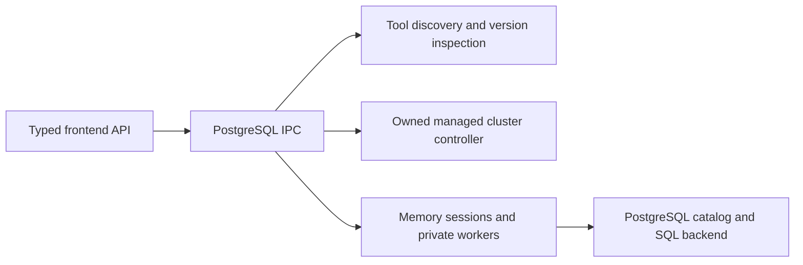

# PostgreSQL integration — Phase 2

Stage 1 implements read-only discovery; Stage 2 adds explicitly authorized managed
lifecycle. Stage 3 adds database-explorer and SQL-editor **backend** contracts and
native workers. No PostgreSQL service starts automatically. No graphical PostgreSQL
workspace, persistent external profiles, role UI or backup/restore UI is implemented.
Signed runtime packaging and real signed-app Keychain acceptance remain unverified;
Stage 3 fixtures do not establish managed release acceptance.

## Stage 3 backend

| Module | Responsibility |
| --- | --- |
| `postgresql/explorer_contract.rs` | Strict target/session/operation/page/query/result/error DTOs; ephemeral password input has no Debug or public serialization |
| `postgresql/explorer/mod.rs` | Memory-only sessions, bounded job registry, unique job IDs, early/session/all cancellation; no external lifecycle authority |
| `postgresql/explorer/sql.rs` | Identifier quoting, validated columns/sort/filter choices, bound values, authorization and input limits |
| `postgresql/explorer/catalog.rs` | PostgreSQL-native database/schema/relation/column/index/view queries with privilege checks |
| `postgresql/explorer/process.rs`, `wire.rs` | Owned private helper, cleared environment, stdin-only secrets, bounded IPC/deadlines and helper memory supervision |
| `postgresql/explorer/native.rs` | Verified libpq, asynchronous connect/query, single-row results, connection-bound cancellation and transaction outcomes |
| `desktop/postgresql_explorer_commands.rs`, `src/postgresql/explorer*.ts` | Explicit typed IPC and frontend foundations; no automatic invocation or workspace UI |

The chosen transport reuses Stage 2's pinned libpq rather than coupling PostgreSQL
to PHP startup or adding a new driver dependency. Existing Fairway job IDs,
operation reservations, private worker transport and exact-value result patterns
are reused; MySQL SQL, credentials, KILL QUERY and service ownership are not.
See [Stage 3 verification and limits](postgresql-stage3-verification.md).

### Connections and ownership

`postgres_connection_open({confirmed:true,database,target})` registers a descriptor;
it returns `authentication:notChecked`, **not** an authenticated/ready claim.
Targets are `{kind:managed,clusterId}` or `{kind:external,host,port,user,password,
transport}`. A job authenticates a new bounded connection against that database.
Select another database by opening another session, using the same explicit policy.
There are at most 16 memory-only sessions and two backend job slots. Desktop query
IPC also uses Fairway's existing operation reservation, serializing it with other
service/database actions. No session/SQL/history/password is written to disk.

Managed jobs recheck the owned, running cluster and verified runtime, resolve only
its Keychain secret, and check the server's database/role/version/data-directory/
cluster-name identity. Unavailable Keychain fails closed; there is no production
managed memory-vault fallback. Client leases are separate shared leases; existing
managed process/runtime leases and ownership receipts remain intact.

External sessions explicitly choose `transport:loopback` and literal `127.0.0.1` or
`::1`; their password is deliberately session-only input, not a persistence fallback.
No server data directory/PID/service identity or lifecycle authority belongs to that
target. `transport:verifyFull` records the required remote policy but currently
returns `unavailable`: the pinned minimal client has no TLS. No downgrade, CA bypass,
external configuration write or personal libpq service/password-file inheritance
occurs. Both paths currently require the separately provisioned verified macOS
arm64 client and a server reporting exactly 18.6; no other version/platform/remote
combination is claimed qualified by these fixtures.

### Catalog, rows and SQL

`postgres_explorer_execute({jobId,sessionId,operation})` accepts these operations:
`databases`, `schemas`, `relations`, `columns`, `indexes`, `view`, `rows`, `query`.
Catalogs use `pg_catalog`, schema-aware identities, privilege checks and bound text
names. Default schema lists omit internal schemas. Relations include ordinary and
partitioned tables, views, materialized views and foreign tables when accessible;
foreign-server behavior is not qualified. Columns include formatted types, defaults,
nullability and identity/generated flags; indexes include primary/unique/valid and
definition; views expose their definition.

Rows validate identifiers as 1–63 UTF-8 bytes without control characters, quote each
schema/relation/column separately with doubled double quotes, and bind every filter,
limit and offset. Sort directions/operators are enums; columns must match catalog
metadata. Filters support equality/inequality, comparisons, literal text contains,
and NULL tests, joined by AND. Native comparison semantics determine type validity;
invalid casts/operators return safe SQLSTATE errors. Primary-key columns break sort
ties; views/unkeyed relations warn about unstable order. Offset pagination always
warns about concurrent changes; no full COUNT, snapshot cursor or keyset protocol
is added. The page response includes `hasMore` from one extra row.

Catalog/browse jobs use read-only transactions. Custom SQL additionally requires
`confirmed:true`; `mode` defaults to `readOnly`. A conservative initial-keyword gate
rejects obvious non-read commands, while the **server read-only transaction** guards
DML hidden in WITH/functions. Explicit `mode:readWrite,confirmed:true` is required
for modifying SQL. The extended query protocol accepts a single statement and bound
text/NULL parameters, without splitting SQL on semicolons. SQL scripts, COPY streams,
manual transactions and commands needing execution outside a transaction are not
supported. Privileged SQL, functions/views/foreign tables and nontransactional
side effects are not sandboxed by PostgreSQL read-only transactions; use least
privilege. See [transaction semantics](https://www.postgresql.org/docs/18/sql-set-transaction.html).

Write jobs commit only after successful bounded result collection. Results/errors
report `outcome`: `notStarted`, `notCommitted`, `committed`, or `unknown`. A lost
commit response/worker transport is never reported as a guaranteed rollback. Even
`notCommitted` does not undo sequence or external-function side effects. Oversized
write RETURNING results are cancelled and commit is not attempted. Read jobs close
without committing. No SQL/parameter/server diagnostic text is logged by the backend.
Managed job sessions suppress value-bearing server diagnostics; logging policy on
externally owned servers remains outside Fairway's control.

Results preserve ordered columns (including duplicate labels) and rows as exact
UTF-8 strings/NULL, with type OID, common type name, modifier and origin metadata.
JSON/JSONB, UUID, arrays, BIGINT/NUMERIC, bytea and timestamps are not coerced through
JavaScript numbers or object maps. Unknown/domain/extension type names fall back
to `oid:<number>`; column inspection supplies PostgreSQL's formatted type. Timezone
is UTC, DateStyle ISO, bytea hex, and float output requests round-trip precision.

### Bounds and cancellation

Initial limits: SQL 64 KiB; 32 parameters of 4 KiB each; page size 50/default and
200/max; offset 100,000; three sorts/eight filters; 128 result columns; 200 query/
catalog rows; 64 KiB per cell; 256 KiB cumulative returned text; 1 MiB private input
and 2 MiB serialized output. Row browsing permits one bounded lookahead row.
Excess query rows are marked truncated and cancelled; oversized cells/bytes fail
with `resultLimit`. These display/resource caps do not pretend to limit SQL effects.

Connection deadline is three seconds; statement timeout ten seconds; lock timeout
one second; worker query deadline twelve seconds; parent helper deadline twenty
seconds. Single-row libpq retrieval avoids buffering an entire multirow result.
The owned helper's physical footprint is sampled every ten milliseconds at 256 MiB;
this is supervision with possible sampling overshoot, not a hard allocation/RSS
sandbox. Unavailable supervision fails closed. Helper core dumps are disabled.

`postgres_explorer_cancel({jobId})` requests cancellation of that job's own libpq
connection, never a supplied backend PID or server process. Bounded early-cancel
markers prevent a cancellation-before-dispatch race; closing a session cancels
its jobs and drops its credential when jobs release their copies. Quit/update
hooks request active-job cancellation through the independent Explorer state.
Private stdin EOF signals owner loss. Short metadata-resolver contention reports
`busy` with `notStarted`, rather than misreporting runtime/vault unavailability;
callers may retry only before dispatch. Cancellation delivery is best effort and
closes the job connection; server deadlines remain a fallback. Only a stalled or
over-budget **client helper** can be forcibly cleaned up, never an external server.
See [libpq cancellation](https://www.postgresql.org/docs/18/libpq-cancel.html) and
[single-row retrieval](https://www.postgresql.org/docs/18/libpq-single-row-mode.html).

## Stage 2 implementation

| Module | Responsibility |
| --- | --- |
| `scripts/prepare_postgresql_runtime.py`, `postgresql-source.lock.json` | Authorized SHA-256-pinned official 18.6 source build in disposable staging, native dependency validation, exclusive payload publication |
| `postgresql/managed/runtime.rs`, `runtime-pin.json` | Reviewed manifest digest, exact file tree/hash checks, private copy, inode ownership and runtime lease |
| `postgresql/managed/files.rs` | Descriptor-relative no-follow filesystem operations, private ownership, hardlink checks, durable journals, exclusive publication and locks |
| `postgresql/managed/mod.rs` | Owned root/cluster receipts, explicit initdb, foreground child, smart shutdown and independent service state |
| `postgresql/managed/secrets.rs` | Native macOS Keychain generic-password items; no renderer password or plaintext fallback |
| `postgresql/managed/health.rs` | Bounded clean-environment pg_isready and private stdin/libpq worker for authenticated identity checks |
| `postgresql/managed/logs.rs` | Private bounded disk capture and recent output; persistent last-log reference |
| `postgresql/managed_contract.rs`, `desktop/postgresql_managed_commands.rs`, `src/postgresql/` | Strict typed IPC, existing desktop operation reservations, separate managed-only API |

[Runtime preparation and release boundaries](postgresql-runtime.md) document the
pin and packaging. [Stage 2 verification](postgresql-stage2-verification.md) records
actual evidence and unresolved signed-app/vault acceptance; this is not release
qualification or permission to begin Stage 3.

The controller creates its own `data/postgresql` only after a confirmed mutation.
Existing roots require an inode-bound owner marker before any lock/journal write.
It uses a separate service lock, runtime lease, random cluster ID, port, Keychain
account, logs and metadata. It never calls MySQL recovery, service managers, brew,
pg_upgrade, shell profiles or external PID-based control. Constructors do no IO;
snapshot/health/log reads do not create a missing root. Existing registered metadata
can be reopened, but a live process is never adopted.

`postgres_managed_{provision,initialize,start,stop,restart}` require explicit
`confirmed:true`. Initialization also accepts a port; no IPC accepts a path,
executable, credential, connection URL, additional PostgreSQL arguments or SQL.
Snapshot/health/logs are separate read commands. The TypeScript API has no automatic
calls, polling or service UI. PostgreSQL is excluded from PHP/MySQL Start All/Stop
All. Quit attempts PostgreSQL, Node and PHP cleanup even if another stack fails;
update installation is aborted when managed cleanup fails. Generic `--remove-data`
refuses any PostgreSQL tree/link instead of deleting a cluster.

Initialization validates the pinned runtime, configured Fairway/HTTPS reservations
and actual loopback bind, then creates and reads back a random 256-bit secret in
Keychain. No cluster directory/initdb is created when the vault fails. Keychain
queries prohibit interactive authentication; unavailable/locked storage fails closed.
The account is an opaque data-root hash plus cluster ID. Credentials never reach
IPC, argv, environment, password files or logs. Test-only memory vaults do not exist
as a production fallback. A private pipe feeds `initdb --pwfile=/dev/fd/0`, with
SCRAM for local/host initialization, UTF-8/C locale and mode-0700 staging.

Only the new stage's config is written: `127.0.0.1`, separate port, Unix sockets
disabled, SCRAM-only host auth for the generated role, all other host/local rules
rejected, password/statement logging disabled. Loopback non-TLS is explicit; remote
connections are unsupported. The protected data tree, cluster inode/marker,
PG_VERSION, pinned runtime and configuration digests are checked before Start.
Unexpected links/hardlinks, foreign ownership, permissive POSIX modes, altered
configuration/auto.conf, occupied ports and any pre-existing postmaster marker
are refused. Same-user hostile modification is not sandboxed by these checks.

A durable nonsecret intent journal precedes the vault write and bootstrap; owned publication and `active.json` use
no-overwrite operations. Failures retain the stage, journal and any already-created
vault item for diagnosis; a vault failure also retains its opaque intent reference. A publication/registration interruption is surfaced and
blocks new initialization; it never auto-adopts, deletes or upgrades that cluster.
There is no automated repair, pruning, password rotation or data-removal API.

Start owns a foreground `postgres` Child and keeps the runtime lease until it exits.
Stop sends PostgreSQL's documented **smart shutdown** SIGTERM to that unreaped child,
never a PID read from a file; it waits ten seconds. Active clients cause an explicit
waiting error and retain the child/lease. Retry after clients finish; Restart starts
only after Stop succeeds. There is no fast/immediate shutdown or forced live-server
kill. Only a timed-out unpublished initdb bootstrap or private health worker can
receive bounded worker cleanup. Child commands clear the inherited environment and
disable core dumps. See [PostgreSQL shutdown modes](https://www.postgresql.org/docs/18/server-shutdown.html).

Process ownership (`running`), responsiveness (`accepting`, `rejecting`, `noResponse`,
`notChecked`) and authentication (`authenticated`, `rejected`, `notChecked`) remain
separate. The private native health worker rechecks the pinned runtime and supplies
only fixed loopback parameters to libpq, with no personal service/password files.
Its fixed, bounded query verifies database, role, server version, data directory
and cluster identity. Raw libpq errors are suppressed. A responsive server with a
wrong/unavailable credential is never reported as authenticated.

Logs are mode 0600, at most 1 MiB per run and 64 KiB in a response. At most 32 retained
log files are permitted; Start then refuses instead of deleting history. Live output
keeps the recent tail; after reopening, the last retained disk capture is bounded
and marked truncated when appropriate. After an app crash or Quit anyway, an orphan
server may remain: Fairway neither signals it nor removes its PID marker. Manual
ownership review is required; automatic process/cluster adoption is deliberately
absent. Smart shutdown may complete later after active clients disconnect.

## Independent ownership and modules

PostgreSQL must be independent of MySQL: separate process ownership, data,
configuration, ports, secrets, logs, backups and health. Do not add it to the current
`Ports` JSON, reuse MySQL credentials, or route it through MySQL Start All/Stop All.
External servers remain externally owned even when Fairway connects to them.

The discovery path below remains the Stage 1 boundary; the managed path above is implemented in Stage 2:

| Module | Responsibility |
| --- | --- |
| `src-tauri/src/postgresql.rs` | Runtime DTOs, typed errors, independent discovery state and inspection gate |
| `postgresql/discovery.rs` | Bounded install-root search, canonical deduplication, native-file checks, fresh candidate selection |
| `postgresql/version.rs` | Fixed clean `--version` commands and stable PostgreSQL version parsing |
| `desktop/postgresql_commands.rs` | Two async Tauri commands, outside the PHP manager lock |
| `src/postgresql/types.ts`, `api.ts` | Matching TypeScript DTOs and explicit command wrappers; no automatic calls or new UI |

Constructing discovery performs no IO. It is registered independently before the
existing startup manager, so a PostgreSQL discovery failure cannot initialize or
repair MySQL/PHP. Existing startup, Node services, database workers, settings,
packaging and runtime locks remain unchanged. The existing bounded command-output
helper is made available on Unix as well as Windows; its implementation is unchanged.

Later modules should remain separate: `managed` (cluster journal/controller),
`profiles` (metadata), `secrets` (OS vault abstraction), `connections` (job/session
ownership), `catalog` (read operations), `query` (explicit SQL), and `backup`.
Do not create these dormant implementations in Stage 1.

## Discovery and version contracts

`postgres_runtime_discover()` returns `{candidates, truncated, notes}`. It reads
only directory entries, executable metadata and four header bytes; it runs nothing.
Sources are the future `runtime/postgresql/bin`, absolute `PGBIN`, standard
Homebrew PostgreSQL/libpq opt directories, Postgres.app version directories,
Linux distro paths, Windows Program Files PostgreSQL version directories, and
absolute entries in the app's inherited PATH. No shell startup or package-manager
command runs. No services, registry service definitions, cluster directories,
`PG_VERSION`, `.pgpass`, `pg_service.conf`, profiles, sockets or ports are inspected.

Search is bounded to 64 roots, 128 entries per version-parent directory and 24
canonical candidates. A truncation flag signals incomplete enumeration. Symlinked
install directories deduplicate to the same bin directory. Relative/empty PATH
entries, control characters, oversized paths and Windows UNC roots are skipped.
Custom prefixes absent from PGBIN/PATH and container/remote servers are not inferred.

Each candidate has a path-derived SHA-256 ID, origin, canonical bin directory,
and these fixed tool slots: `postgres`, `initdb`, `pg_ctl`, `psql`, `pg_isready`,
`pg_dump`, `pg_restore`, `pg_dumpall`. Missing tools remain missing. A client-only
libpq install does not imply a local server. The `fairwayRuntime` origin describes
where tools were found; it never grants ownership of a cluster/process.

`postgres_runtime_inspect({candidateId, confirmed:true})` refreshes discovery before
selection and runs only native fixed-name executables with exactly `--version`.
It accepts no executable path, shell command, connection URL or additional arguments.
Native-format headers and executable permissions are checked; wrappers/scripts,
special files and tool symlinks escaping the canonical bin are refused. Files are
opened without following final symlinks and nonblocking on Unix, then checked again
before probing. This is a safety filter, not signature validation or a sandbox
against malicious native code or same-user path replacement. A candidate ID is
not a persisted execution/ownership token; Stage 2 must revalidate tools and files.

The child environment is cleared; only C locale and Windows SystemRoot are set.
No inherited PGDATA, PGHOST, PGPASSWORD, loader hooks or shell config reach it.
Each command has a two-second maximum; the candidate has an eight-second scheduling
budget (a final rounded one-second probe can extend it by less than one second).
Output capture is bounded by the existing helper; timeout/cancel cleanup uses only
its owned process group/job. Calls cannot overlap version inspection. Raw stdout,
stderr, environment and exception details never enter diagnostics or IPC errors.

Only stable numeric releases are parsed, including legacy three-part versions.
Prereleases, wrong tool banners, malformed and multiline output are rejected.
Vendor annotations are discarded. `serverTools` checks postgres/initdb/pg_ctl;
`clientTools` checks the five clients separately. `verified` means all tools in
that group returned the same exact version. It does not mean compatibility,
authentication, readiness, a qualified managed release or client/server compatibility.
The groups may have different versions and must not be conflated. Tool issues and
missing/mixed groups remain explicit. No support range is guessed from folder names.

Errors are `busy`, `confirmationRequired`, `staleCandidate`, or `unavailable`.
Request DTOs reject unknown fields. IPC version inspection has no disk persistence,
credential input, network operation, start/stop or mutation endpoint.

## Historical connection/profile plan (persistent profiles remain future work)

Use a discriminated target: `{kind:managed, clusterId}` or
`{kind:external, profileId}`. A runtime toolset ID is neither target type.

- Managed metadata: random cluster ID, format revision, pinned tool receipt,
  PostgreSQL major, canonical owned data directory, loopback host/port and a vault
  secret reference. Proposed private roots are `data/postgresql/{clusters,config,
  logs,backups}`. Treat 15432 as a proposed configurable default, never a detected
  listener or reserved port. Validate conflicts with every Fairway service and the
  actual bind, without killing another listener. No paths/ports are created now.
- External profile: random ID, label, host/port or explicit local socket, database,
  username, TLS policy/CA reference and optional vault reference. No data-directory,
  process/PID ownership, cluster initialization or service-manager authority.
  Remote profiles need no local PostgreSQL installation for PHP-driver access.
- Persist only versioned metadata, using owned private files, inode/link checks,
  atomic no-overwrite publication where applicable, durable journals and explicit
  recovery. Refuse unknown/nonempty cluster roots. Never adopt a cluster from its
  path, PID file, open port, Homebrew origin or matching executable name alone.
  No automatic upgrades, repairs, data-directory deletion or pg_upgrade.
- Password persistence must use an OS credential vault (Mac Keychain, Windows
  Credential Manager, appropriate Linux secret service), with opaque references.
  When unavailable, use memory-only credentials or refuse password persistence.
  Never fall back to plaintext config, generated `.pgpass`, SQL history, logs,
  argv or password-bearing URLs. No vault API is called in Stage 1. Later CLI
  backup authentication must resolve secure credential delivery before release;
  a mode-0600 password file still violates this project's no-plaintext-storage rule.
- Remote TLS should default to `verify-full` with explicit CA/hostname validation;
  local non-TLS must be an explicit loopback-only choice. Do not inherit personal
  libpq service/password files or silently downgrade security. See the official
  [libpq TLS behavior](https://www.postgresql.org/docs/18/libpq-ssl.html).

A future health response should distinguish transport reachability, acceptance
(`accepting`, `rejecting`, `noResponse`, `notChecked`), authentication
(`authenticated`, `rejected`, `notChecked`), and managed process ownership
(`owned`, `external`, `unknown`). Include profile revision and server-reported
version/database identity only after an explicit bounded connection test. Do not
infer a server version from client binaries. `pg_isready` tests acceptance without
proving correct credentials and can produce server log entries, so Stage 1 never
uses it except `--version`. See its [documented status semantics](https://www.postgresql.org/docs/18/app-pg-isready.html).
Only authenticated access to the intended database plus a successful bounded
query can establish application access; process existence and TCP are insufficient.

Managed lifecycle must reserve its own runtime lease, own the foreground process
or Windows job, record recoverable creation progress and revalidate cluster identity
before control. Quit/update cleanup may stop only Fairway-owned PostgreSQL. External
connections may be closed/cancelled; their servers must never be stopped.

## Existing components to reuse carefully

| Existing component | Reuse | PostgreSQL-specific boundary |
| --- | --- | --- |
| `process.rs`, Node supervisor/lifecycle | Owned process groups/jobs, leases, quit/update reservations | Do not reuse PID-only `adopt_database` or MySQL recovery/control commands |
| `durability.rs`, safe Node filesystem operations | Private staging, receipts, atomic publication, journals | Define PostgreSQL ownership roots; do not copy MySQL upgrade behavior |
| `data_browser.rs` | Private stdin/stdout worker design, bounded results, job IDs, cancellation structure | Separate job registry, connection resolver and PostgreSQL adapter; no `connection(layout)` MySQL prerequisite |
| Bundled PHP `pdo_pgsql` / `pgsql` | Initial transport candidate without a new runtime dependency | New private worker using explicit profile/vault data; qualify drivers before enabling connections |
| `RowViewer`, `TableWorkspace`, `query-results`, `row-values`, `Dialog`, `ActionMenu` | Exact string/NULL rendering, pagination controls, dialogs, results and focus patterns | Add schema identity and engine capabilities; keep MySQL/SQLite behavior and tests |
| MySQL/SQLite workers and forms | Safety patterns only | Do not reuse backticks, MySQL catalogs/KILL QUERY/unsigned/AUTO_INCREMENT, SQLite rowid or shared MySQL credentials |

The Stage 1 transport candidate was a separate PHP PostgreSQL worker, because
Fairway already ships both drivers. Confirm cancellation via the connection's own
`pg_cancel_query`/libpq cancel handle before choosing PDO-only execution; do not
cancel arbitrary server backend PIDs. A Rust driver remains an alternative if the
PHP adapter cannot meet isolation, TLS, exact-value or cancellation requirements.
Stage 3 instead selects the existing pinned native libpq worker above, with no new dependency. See official
[connection-bound cancellation](https://www.postgresql.org/docs/18/libpq-cancel.html).

## Explorer and administration plan

The navigation key is **profile → database → schema → relation**, not MySQL's
single database/table pair. Reconnect to the selected database using the same
profile policy. Read permitted databases, then schemas (`pg_namespace`), tables/views,
columns/types/defaults/identity/generated markers, ordered keys/indexes and
relationships using PostgreSQL catalogs and privilege checks. Schema names are
separate identifiers; never concatenate schema-qualified user text into SQL or
rely on an inherited search_path. See [schema catalog semantics](https://www.postgresql.org/docs/18/catalog-pg-namespace.html).

Start with browsing only. Send profile/database/schema/relation identity plus a
native job ID and bounded page parameters (default 50, maximum 200 rows). Quote
identifiers in the adapter, bind values, preserve BIGINT/NUMERIC/NULL/bytea/arrays
and JSON as exact display strings with type metadata. Cap cells, total payload
and query time. Prefer keyset paging on a verified stable unique key; offset pages
without one must warn that concurrent writes/order can change results. Avoid
mandatory full COUNT on large tables. LIMIT/OFFSET needs explicit ordering for
predictable pages; see [PostgreSQL SELECT](https://www.postgresql.org/docs/18/sql-select.html).

Later SQL editor: explicit execution only, per-profile/database context and TLS,
1 MiB input/200 displayed rows/ten displayed result sets as initial limits to
qualify, statement/lock deadlines and connection-bound cancellation. Display limits
must not masquerade as execution guards. Do not split SQL on semicolons (dollar
quotes, functions and transaction blocks). Roll back unfinished transactions,
report partial effects honestly, never persist secrets in history, and gate writes
separately from read browsing. Arbitrary SQL can change data; confirmation does
not make it transactional or automatically backed up.

Later role management: inspect privileges first; avoid automatic superuser grants,
quote role identifiers and confirm changes. Never expose password hashes. Backup:
validate pg_dump/server compatibility; custom archives use pg_restore, plain SQL
uses a reviewed SQL restore path. Publish complete exports atomically without
overwrite; provide protective backups/explicit restore consent and clearly report
partial effects. Database dumps do not include global roles/tablespaces; plan a
separately authorized pg_dumpall globals path. Restores can execute code and must
never auto-run downloaded dumps. See [pg_dump behavior and version compatibility](https://www.postgresql.org/docs/18/app-pgdump.html).

## Stage 4 readiness

The backend is ready for a separately authorized graphical integration against its
qualified macOS arm64/18.6 development path. Stage 4 should bind session/operation
contracts to navigation, schema-aware tables, exact-value cells, SQL mode consent,
cancel controls, truncation and uncertain-commit states. Do not add automatic service
startup or external ownership. No Stage 4 implementation has begun.

Signed runtime packaging, real signed-app Keychain acceptance, remote TLS/client
qualification and other platform/server combinations remain outstanding. Backend
fixtures do not establish real managed-cluster or release acceptance. Persistent
profiles, roles and backup/restore remain separately scoped future work.

[Stage 1](postgresql-stage1-verification.md), [Stage 2](postgresql-stage2-verification.md)
and [Stage 3 verification](postgresql-stage3-verification.md) distinguish historical
evidence from current implementation and unresolved acceptance.
